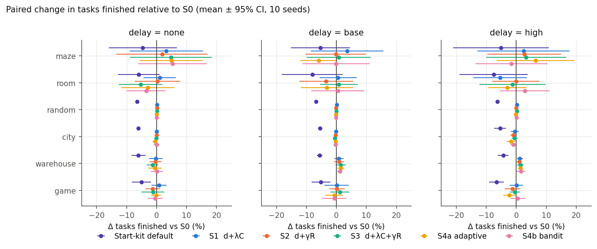
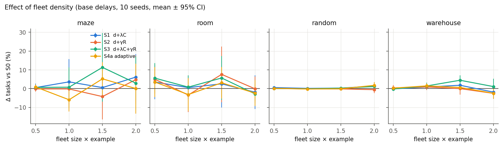
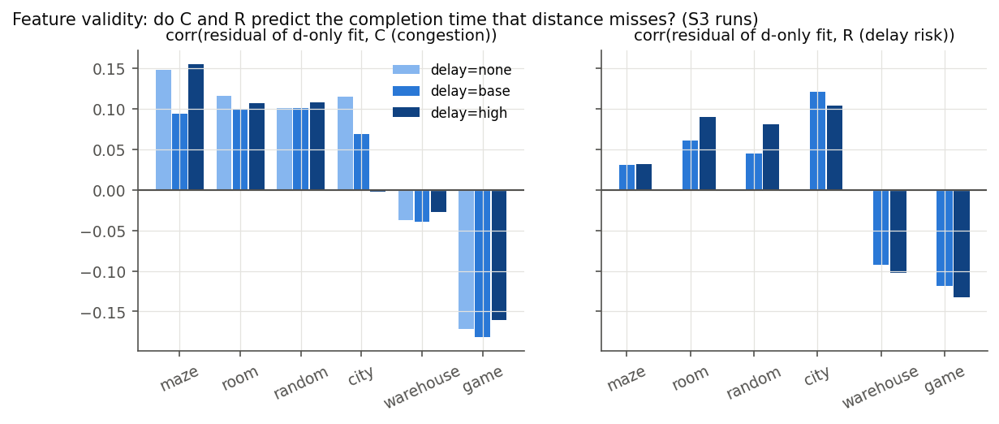
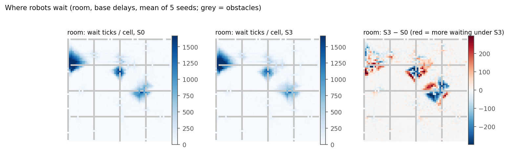
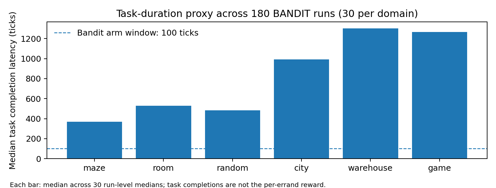

# Congestion- and Delay-Aware Scheduling for Lifelong MAPF

**CS5446 Reinforcement Learning and Sequential Decision Making · AY2026/27 Sem 1 · Team 27**
Competition project: [League of Robot Runners (LoRR) 2026](https://github.com/MAPF-Competition/Start-Kit), Task Scheduling Track.

We built a task scheduler for the official LoRR 2026 C++ start-kit that scores each robot–task pair with

```
S = d + λC + γR        d = distance,  C = congestion exposure,  R = delay risk
```

and evaluated it, together with two adaptive extensions, in 2,326 full simulations.
**Main result:** the *matching rule* matters far more than the extra score terms.
Relative to our distance-only global greedy matcher (S0), the start-kit default finishes
**5.9% ± 1.3% fewer tasks** (S0 wins 156 of 180 paired runs), while adding congestion and delay terms
changes throughput by only −0.4% to +0.5%, which is not significant.

---

## Problem background

* **Lifelong multi-agent path finding.** Hundreds to 10,000 robots share a grid map (warehouse, city, game maps…).
  Tasks keep arriving; each task is a chain of errand cells that a robot must visit in order.
* **Only the scheduler is ours.** In the Task Scheduling Track the path planner and executor are fixed.
  At least once per simulated second the scheduler sees the robots (positions, headings, `inDelay` flags) and the
  task pool, and assigns free robots to free, unopened tasks. The objective is tasks finished within the horizon.
* **Hidden execution delays.** LoRR 2026 randomly stops robots for several ticks. Only the delay *family* is public,
  so the delay rate and duration must be estimated online.
* **Research question.** When, and by how much, do congestion- and delay-aware assignments improve throughput over
  distance-only assignment?

We model this as a partially observable sequential decision problem and study myopic score-based policies
`π_t = argmin_π Σ_i S_θ(i, π(i) | o_t)` with interpretable weights `θ = (λ, γ)` that are fixed, state-adaptive, or learned online.

## Method

| Scheduler | Score | Notes |
|---|---|---|
| `DEFAULT` | d | start-kit baseline: robots in hash-set order each take their nearest task |
| `S0` | d | **our global greedy matcher** (shared by S0–S4b): each robot proposes its 16 nearest tasks, all proposals are sorted, best pairs are committed first |
| `S1` | d + λC | congestion: route length × (robot density + 2 × stalled-robot density) + competitors heading to the same blocks |
| `S2` | d + γR | delay risk: own remaining delay + delay exposure in corridors + delayed robots on the route; delay rate/duration estimated online from `inDelay` flags |
| `S3` | d + λC + γR | full score, (λ\*, γ\*) = (2, 1) tuned on separate seeds |
| `ADAPT` (S4a) | d + λₜC + γₜR | weights scale with the observed share of stalled / delayed robots |
| `BANDIT` (S4b) | d + λₜC + γₜR | discounted-UCB bandit over 6 weight multipliers, one arm per 100-tick window |

All terms are measured in action steps, so λ and γ are dimensionless.

## Key findings

| vs S0 (180 paired runs: 6 maps × 3 delay levels × 10 held-out seeds) | Δ tasks finished (95% CI) |
|---|---|
| Start-kit default | −5.88% ± 1.31 |
| S1  d + λC | +0.45% ± 1.26 |
| S2  d + γR | −0.06% ± 1.25 |
| S3  d + λC + γR | +0.17% ± 1.28 |
| S4a adaptive | −0.41% ± 1.14 |
| S4b bandit | +0.24% ± 1.18 |

* On the 10,000-robot iron-harvest map, S0 finishes 2.2× as many tasks as the default (837 vs 382).
* The only hint of a congestion effect is in the warehouse at 1.5× fleet size, at the onset of congestion collapse:
  +4.4% ± 2.6% (p = 0.004), which is not significant after Holm correction.
* Why the terms do not help: LoRR delay onsets are i.i.d. over robots and ticks, so delay history does not predict future delays;
  and waiting concentrates at junctions that every route must cross. Given d, the C and R terms add at most 0.018 to the
  R² of a completion-time model.

---

## Published figures and numerical summaries

The following figures come from the **original 2,326-run study** (six domains, three delay regimes,
10 held-out seeds per main comparison); they are *not* from the six-run quick-start demo.
The original complete simulator traces are not stored in GitHub, but selected derived CSVs
and the original exported PNG figures are in [`published_results/`](published_results/README.md).

**Main ablation — paired throughput changes relative to S0.** The dominant effect is the
start-kit default's lower throughput; adding C/R and adaptive weights shows no stable pooled improvement.



**Density — exploratory heterogeneity, not a separately confirmed claim.** The warehouse
S3/S0 gain at 1.5× (approximately +4.45%) did not survive the original familywise
multiple-comparison correction.



**Mechanism diagnostics.** The feature-validity and waiting heatmaps explain how congestion
signals can have limited additional predictive and decision value.





Additional figures and source numeric tables: [`assets/figures/`](assets/figures/),
[`published_results/tables/`](published_results/tables/).

## Exploratory follow-up

Three separate post-hoc investigations supplement **but do not replace** the original main results:

| Question | Observed result | Limitation |
|---|---|---|
| **A: density criticality** | Original warehouse S3/S0: −0.19% at 0.5×, +4.45% at 1.5×. New 0.5× seeds 20–22: −0.82% mean. | Bootstrap of old seeds is not independent confirmation. |
| **B: topological alternatives** | 24 new Room passages raised throughput of both S0 and S1; mean S1/S0 interaction −0.69 pp across three seeds. | Map distances also changed. |
| **C: delayed feedback** | Across 180 BANDIT runs, median run-level task completion time 840 ticks vs 100-tick arm windows; 99.28% crossed a window. | Task-completion proxy, not direct per-errand reward credit attribution. |



Source, diagnostics, and method constraints: [`docs/followup-results.md`](docs/followup-results.md),
[`followup/`](followup/), [`published_results/followup/`](published_results/followup/).

## Requirements

* Linux or macOS, Git, a C++17 compiler, CMake ≥ 3.16, Boost (program_options, system, filesystem, log, log_setup), pybind11
* Python ≥ 3.9 with development headers/libraries (the simulator embeds Python; experiment scripts use only the standard library)

```bash
# Ubuntu / Debian
sudo apt install git build-essential cmake libboost-all-dev python3-dev python3-venv python3-pip
# macOS (Homebrew)
brew install cmake boost python
```

## Quick start (about 5 minutes)

```bash
git clone https://github.com/Ningyu329/cs5446-lorr-scheduling.git
cd cs5446-lorr-scheduling

python3 -m venv .venv
source .venv/bin/activate
python -m pip install pybind11 pytest

scripts/build_startkit.sh          # clones the official start-kit (pinned commit), installs our scheduler, builds ./lifelong (~1 min)
python3 scripts/ray_sweep.py experiments/configs/quick.json --local 3   # 6 runs, ~3 min with 3 parallel workers
python3 scripts/quick_summary.py --config experiments/configs/quick.json
```

The first build downloads the official simulator and its example maps, so it needs Internet access.
No separate Google Drive dataset or previous experiment results are required. Generated inputs go to
`data/generated/` and outputs to `results/runs/quick/`; both are ignored by Git.
The summary checks that **all six configured runs** have both a `DONE` marker and a summary.
An incomplete experiment or simulator errors cause a nonzero exit status.

Use `--local 1` instead of `--local 3` on a machine with fewer than six available CPU cores.
Build parallelism defaults to two jobs; use `JOBS=4 scripts/build_startkit.sh` to change it.

`quick.json` runs the 400-robot `random` map with the official delays for 1,000 ticks on 2 seeds, comparing
`DEFAULT`, `S0` and `S3`. Expected output (counts vary slightly between machines, because the planner is wall-clock bounded):

```
Tasks finished (quick, 1000 ticks)

instance                     DEFAULT        S0        S3
--------------------------------------------------------
random m1 base s0                674       744       736
random m1 base s1                648       706       696

Mean paired change in tasks finished vs S0
  DEFAULT   -8.81%   (2 pairs)
  S3        -1.25%   (2 pairs)

6 runs, planner/schedule errors + timeouts: 0
```

This is a **smoke test**, not a performance acceptance threshold. Check that all six runs finish,
the table has DEFAULT/S0/S3 for both seeds, and planner/schedule errors + entry timeouts are zero.
Counts and rankings can differ on another machine: the planner has a wall-clock budget.
Two seeds are far too few for inference; the full study uses 10 held-out seeds per cell.

**A single run** (any map, scheduler and weights):

```bash
python3 scripts/lorr_job.py --domain maze --delay base --sched S3 --lam 2 --gam 1 --horizon 500
```

Maps: `maze` (40 robots), `room` (150), `random` (400), `city` (600), `warehouse` (2,500), `game` (1,800), `iron` (10,000).
Delay levels: `none`, `base` (official configuration), `high` (8× delay load, capped).

**Tests** (43 tests; the scheduler integration tests run the real binary and typically take at least 40 s):

```bash
python3 -m pytest tests/
```

Build first: the 16 C++ integration checks are skipped when `lifelong` is absent.
The other tests cover the Python prototype and quick-start failure handling.
For analysis/figures or Ray cluster sweeps, install the optional dependencies inside the same virtual environment:

```bash
python -m pip install -r requirements.txt
```

**Troubleshooting**

* Compiler or dependency errors: the full diagnostics are in `third_party/Start-Kit/cmake.log`
  and `third_party/Start-Kit/build.log`. A failed build stops the script even if an older binary exists.
* Multiple Python installations: activate the virtual environment first, or set
  `PYTHON=/absolute/path/to/python scripts/build_startkit.sh`. Additional CMake options can be passed
  after the script name; for a nonstandard Boost installation, set `CMAKE_PREFIX_PATH` to its prefix.
* Interrupted sweep: rerun the same sweep command. Completed jobs are skipped; failed jobs are retried.
  Run the summary with `--config` after the sweep to check completeness.
* A different Start-Kit checkout is already present: the build script requires commit
  `9bc75d9dd9883de049294ab2981bf325bbe19d49` and stops rather than overwriting another version.

See [the quick-start validation record](docs/quick-start-validation.md) for a tested environment,
commands, and observed output. It validates the small demo rather than the full study.

## Full reproduction

The simulator advances one tick per 100 ms of wall-clock time, so a 3,000-tick run takes about 5 minutes regardless of CPU speed,
and each run should get **2 dedicated CPU cores**: the planner is time-bounded, so oversubscription changes results, not just speed.

| Config | Runs | What |
|---|---|---|
| `experiments/configs/quick.json` | 6 | smoke test above |
| `experiments/configs/tune.json` | 400 | λ, γ sweeps on tuning seeds 100–104 |
| `experiments/configs/main.json` | 1,320 | 6 maps × 3 delay levels × 7 schedulers × held-out seeds 0–9, plus noise-floor repeats |
| `experiments/configs/density.json` | 600 | fleet size 0.5×, 1.5×, 2× on 4 maps |
| `experiments/configs/scale.json` | 6 | iron harvest, 10,000 robots |

```bash
python3 scripts/ray_sweep.py experiments/configs/main.json             # on a Ray cluster ($RAY_ADDRESS, default "auto")
python3 scripts/ray_sweep.py experiments/configs/main.json --local 8   # or a local process pool (8 runs ≈ 16 cores)
python3 analysis/make_figures.py                                        # tables and figures (needs requirements.txt)
```

The full study took about 349 CPU-hours. Sweeps are resumable: finished runs (with a `DONE` marker) are skipped.
Each run writes `results/runs/<phase>/<job>/` containing `summary.json` (all metrics), `assigns.csv.gz`
(every assignment with predicted d/C/R and the realised completion time), `output.json.gz` (start-kit output, loadable in PlanViz),
`stats.json.gz` (scheduler telemetry) and `run.log`. Scratch files go to `$LORR_SCRATCH` (default: the system temp dir).

## Repository layout

| Path | Content |
|---|---|
| `sched/` | C++ scheduler (`cda_scheduler.{h,cpp}`) and the start-kit `TaskScheduler.cpp` dispatcher |
| `scripts/build_startkit.sh` | clones LoRR Start-Kit v3.1.0 (commit 9bc75d9) into `third_party/`, installs the scheduler, builds |
| `scripts/make_instances.py` | seeded instance variants (fleet size, delay level, seed) of the official 2026 example maps |
| `scripts/lorr_job.py`, `scripts/ray_sweep.py`, `scripts/expand.py` | one run / resumable sweep of a config / config expansion |
| `scripts/quick_summary.py` | dependency-free paired comparison table for a finished phase |
| `scripts/sanitize_artifacts.py` | strips host names, IPs and absolute paths from run artefacts (`--check` gate) |
| `experiments/configs/` | the configs listed above |
| `analysis/` | paired statistics (Wilcoxon, Holm), tables and figures; standalone plotter for released summary CSVs |
| `assets/figures/` | published original PNG plots and one follow-up plot |
| `published_results/` | original derived numeric CSVs and separate A/B/C pilot summaries |
| `followup/` | independent exploratory diagnostics and pilot scripts |
| `lorrsim/`, `scripts/run_experiments.py`, `scripts/feature_validity.py`, `tests/test_lorrsim.py` | earlier pure-Python prototype simulator (kept for reference; not used for the reported results) |
| `tests/test_cda_scheduler.py` | integration tests against the real start-kit binary (pin two bugs found during the study) |

Instances are generated from the official example problems in `third_party/Start-Kit/example_problems`
(or from `data/instances` if that directory exists). Agent and task files depend only on (map, fleet size, seed),
so every scheduler and delay level sees identical robots and tasks, and all comparisons are paired.

The scheduler is configured through environment variables read by the `lifelong` binary:
`LORR_SCHED` (`DEFAULT`, `S0`, `S1`, `S2`, `S3`, `ADAPT`, `BANDIT`), `LORR_LAMBDA`, `LORR_GAMMA`, `LORR_K` (shortlist size),
`LORR_BANDIT_WINDOW`, `LORR_SEED`, `LORR_HORIZON`, `LORR_STATS` (telemetry output path); see `sched/cda_scheduler.cpp`.

The report, paper, generated instances and complete per-run simulator results are not included. Selected original derived tables, PNG figures, and separately labeled exploratory follow-up summaries are included in `published_results/` and `assets/figures/`. The original `analysis/make_figures.py` still requires full raw results; `analysis/plot_published_tables.py` works with the released derived tables.

## Team

Han Zeyuan · Su Jiaqi · Tong Yupeng · Wang Ningyu · Wang Shuntao · Yang Junyao
