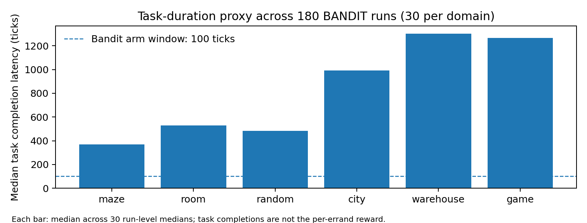

# Exploratory follow-up on congestion, topology, and delayed feedback

Date: 15 November 2026. **Separate from the original 2,326 full simulations.**

## A: Density criticality

In the original warehouse density sweep, S3/S0 mean paired throughput changes
were -0.19% at 0.5× and +4.45% at 1.5×, an exploratory difference of
+4.64 percentage points. Bootstrap percentile intervals on the *same existing*
10 seeds were [-1.16%, +0.67%] (0.5×), [+2.30%, +6.59%] (1.5×), and
[+2.33, +7.04] pp (difference). Since the 1.5× cell was noticed after a
multi-cell search, these intervals are descriptive, not independent replication.
The original density-cell tests did not survive the reported Holm adjustment.

New seeds 20–22 at warehouse 0.5×: S3 vs S0 = -1.54%, -1.58%, +0.67%
(mean -0.82%). All six paired runs completed. The attempted 1.5× simulations
(same new seeds, both policies) were OOM-killed by the local WSL environment:
**there are no valid new 1.5× outcomes**. No new high-density confirmation
should be claimed. See `published_results/followup/low_density_pilot.csv`.

## B: Topological avoidability probe

A controlled Room pilot opened 24 blocked cells forming additional passages,
without replacing the fixed planner. S0 and S1 were compared on each version
using matched seeds 20–22. The mean S1/S0 change was -1.10% on the original
map versus -1.80% on the bypass map (interaction -0.69 percentage points).
The direction varied by seed; the bypass-benefit hypothesis was **not supported**.
Topology itself dramatically boosted total throughput, but changes in map
distance and planner behavior also occur. Thus this does not causally isolate
'avoidability' from geometry and planning. Full data:
`published_results/followup/bottleneck_pilot.csv`.

## C: Bandit feedback timing

Analyzing all 180 original main-study BANDIT run logs, the median across runs
of median task completion time is 840 ticks; the median across runs of task
completions crossing a 100-tick arm window is 99.28%, and the median across
runs of completion under a different arm is 84.17%.
These are per-run median/proxy statistics; original BANDIT reward was completed
**errands per window**, not completed tasks. With six nearly uniformly chosen
arms, 5/6 = 83.33% different-arm agreement is already a near-chance baseline.
The audit identifies a **feedback timescale mismatch**, not proof that it
caused the BANDIT arm-selection algorithm's weak throughput performance.

## Overall finding and limitations

Extra state features are not automatically valuable to a downstream scheduler:
observed density regime, structural constraints, limited predictive signal,
and delayed reward feedback can all be relevant. These studies are exploratory
and do not establish a causal law. Keep the original main pooled and corrected
results as the primary empirical finding, and report the inconclusive probes.
